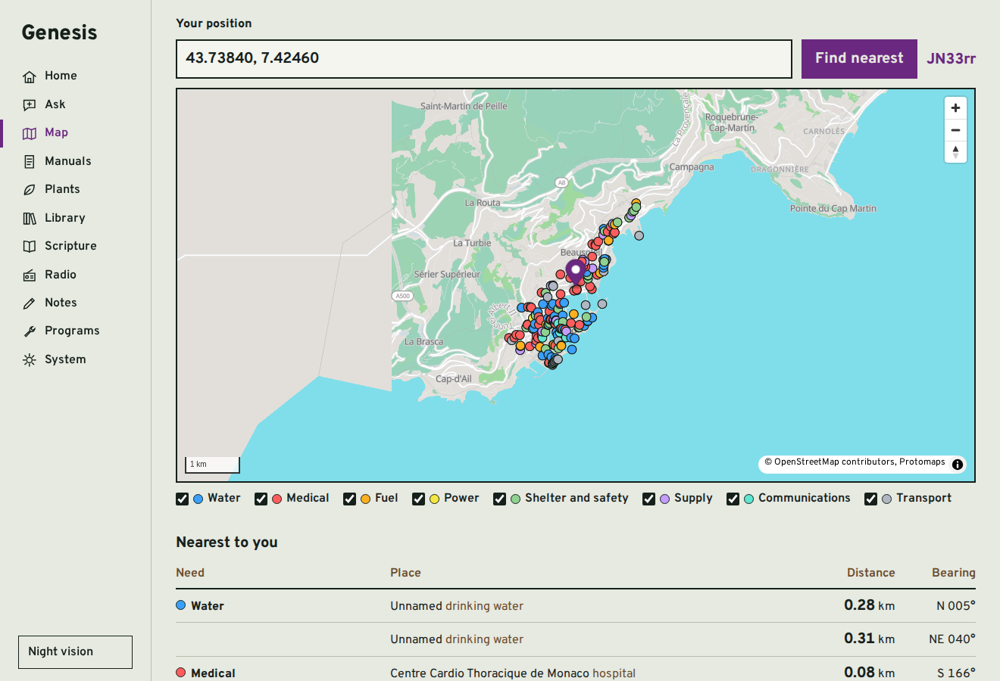
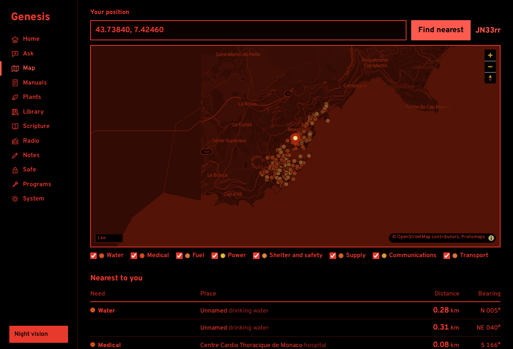

# Genesis

**Everything you need to begin again.**

[](https://github.com/Firegod1991/genesis/actions/workflows/ci.yml)
[](https://github.com/Firegod1991/genesis/actions/workflows/refresh.yml)
[](https://github.com/Firegod1991/genesis/actions/workflows/assets.yml)

Genesis turns any computer into a self contained command center that keeps working when the internet, the power grid and the phone network do not. One catalog tracks the newest version of everything worth keeping: the world's knowledge, maps of the whole planet, where the water, hospitals, fuel and power are, the Bible from its ancient source languages to today, radio and mesh communications, local AI, programming toolchains and bootable operating systems. One command downloads and verifies it. A robot refreshes the catalog every month.



The repository holds the brain: the catalog and the tools. Your drive holds the vault: the content itself, from 24 GB to more than 2 TB depending on the tier you pick.

## What is in the catalog

2,824 items at launch (November 2026). The full list with versions and sizes is generated into [docs/CATALOG.md](docs/CATALOG.md) on every refresh.

| Pack | What you get |
|---|---|
| **Knowledge** | Wikipedia in 318 languages, Wikivoyage, Wikibooks, Khan Academy, Stack Exchange, textbooks |
| **Medical** | WikiMed in 26 languages, MDWiki, MedlinePlus, NHS medicines, military medicine, veterinary references, the WHO monographs on medicinal plants, an evidence graded guide to emergencies |
| **Survival** | US Army field manuals, Ready.gov, water, food and post disaster libraries, iFixit repair guides, the Survivor Library, and a field skills shelf of primary source manuals (see below) |
| **Maps** | The whole planet as offline vector maps, cut to any region in minutes, plus worldwide survival layers |
| **Scripture** | 1,296 Bible translations in 1,024 languages from eBible.org, starting with the Hebrew, Greek, Latin and Coptic sources, plus the people, places and events of the Bible as linked data |
| **Library** | Project Gutenberg in about one hundred languages, Wikisource, sheet music |
| **Radio** | SDR receivers, ham digital modes, Winlink, Meshtastic, MeshCore and Reticulum firmware and apps, the FCC callsign database, satellite orbits and pass prediction, a decoder for weather stations and other wireless sensors, shortwave schedules |
| **Code** | The newest stable Go, Rust, Python, Node, Zig, Java, .NET, Julia, Dart, Kotlin and more as offline archives for Linux, Windows and macOS, editors, and documentation for 240 languages and frameworks |
| **Operating systems** | Ubuntu, Debian, Mint, Kali, Tails, Arch, Fedora, Alpine, Proxmox, OpenWrt, Raspberry Pi OS and rescue disks, each pinned to its newest release and official checksum |
| **Local AI** | Current open models sized for a Raspberry Pi, a gaming GPU or a workstation, with medical, translation, coding, reasoning, document reading and speech models |
| **Phone apps** | Android apps to side load over the hotspot: offline maps, mesh messaging, file sharing, calls on the local network, readers, survival tools |
| **Tools** | Portable readers, USB writers, file sharing, encryption, text recognition, CAD and 3D printing, backup and capture tools for every desktop platform |
| **Services** | 25 container images behind the dashboard, each checked monthly |

## Tiers

Tiers are cumulative. Sizes are for English content on Linux; more languages add more.

| Tier | Size | For |
|---|---|---|
| **seed** | about 24 GB | A USB stick or a Raspberry Pi. The essentials in every pack. |
| **ark** | about 780 GB | A 1 TB drive. Full Wikipedia with images, field manuals, every toolchain. |
| **eden** | about 2 TB | Everything, including the full detail planet map and the largest libraries. |

## Quick start

On Debian, Ubuntu or Raspberry Pi OS:

```sh
git clone https://github.com/Firegod1991/genesis
cd genesis
bash install.sh                 # base packages, Docker if you agree, the genesis command
genesis doctor                  # what this machine can carry
genesis plan --tier seed        # what it costs in disk space
genesis fetch --tier seed       # download and verify, four files at a time
genesis up core                 # dashboard at http://localhost:8080
genesis timer                   # update everything once a month
```

Put the vault on another drive with `export GENESIS_VAULT=/mnt/bigdrive/genesis`.

Everything below works with nothing but Python 3 and curl, so the catalog and the vault tools also run on macOS and straight on Windows, where the dashboard starts by itself and the other services wait for Docker:

```powershell
py -m genesis doctor
py -m genesis fetch --tier seed --vault E:\genesis
$env:GENESIS_VAULT = "E:\genesis"
py dashboard\server.py          # dashboard at http://localhost:8080
```

Filling a drive on one machine for another? Name the machine it is for. `genesis fetch --tier seed --platform linux-arm64,android` loads a drive for a Raspberry Pi from any computer. The AI models ride along when Ollama is installed on that computer: they go into the vault, never into your own model library.

## Find water, care, fuel and power with no network

Genesis builds **survival layers** from OpenStreetMap: drinking water, springs and wells, hospitals, clinics and pharmacies, fuel stations, power plants and substations, shelters, fire and police stations, supply stores, communications towers, airfields and harbors.

```sh
genesis fetch --id survival_layers_world       # the whole world, prebuilt monthly
genesis poi build --region us/california       # or build any region yourself
genesis poi nearest --lat 43.7384 --lon 7.4246 --cat water
```

```
   0.00 km N   water     drinking_water   Fontaine du Port  (43.73840, 7.42460)
   0.26 km NE  water     spring           unnamed  (43.74000, 7.42700)
```

The dashboard shows the same thing on a map and lists the nearest of each need by distance and compass bearing, so you can walk there with a compass.

## Field skills

The seed tier carries a shelf of manuals from the agencies that wrote them, as plain PDF files the dashboard serves to any phone or laptop on the hotspot.

| Skill | What is on the shelf |
|---|---|
| Staying alive | The US Army survival manual: water, food, fire, shelter, medicine, movement |
| Plants | Edible plant guides for every region of the United States (table below), a guide to edible and poisonous mushrooms, the USDA guide to poisonous plants |
| Plant medicine | The four volumes of WHO monographs on medicinal plants: uses, evidence, doses, dangers |
| Game and fish | The North American trapper education manual, field dressing and storing meat, basic fishing |
| Water | WHO technical notes on making water safe, cleaning wells and tanks, and sanitation |
| Finding your way | Basic Land Navigation from the National Wildfire Coordinating Group: maps, compass, GPS |
| The sky as clock and calendar | Printable star wheels for seven latitudes, Stellarium for the desktop, Sky Map for the phone |

```sh
genesis fetch --tag fieldcraft        # only this shelf, about 0.8 GB
```

A star wheel shows which constellations are up at any date and hour. Turn it until it matches the sky: with the date you read the hour, with the hour you read the date.

### Edible plants by region

No single free book covers every edible plant in the United States, so the shelf carries the best free source found for each region and two books that span the country.

| Region | On the shelf |
|---|---|
| Whole country | Useful Wild Plants of the United States and Canada (1920), and the USDA list of 1,112 food plants with the part eaten and how it was prepared |
| Northeast | Edible wild greens of Maine. Iroquois food plants, with how corn, beans and squash were grown, stored and cooked |
| Great Lakes | Plants used by the Chippewa, wild rice and maple sugar among them |
| Southeast | A foraging primer from Mississippi State University with a table of common wild food plants |
| Midwest | Wild Edibles of Missouri |
| Great Plains | Plants of the Missouri River tribes. About 80 plains plants with photos from the USDA |
| Rocky Mountains | The wild berries and other wild fruit of Wyoming, inside a home canning manual written for high altitude |
| Southwest | Desert Foods from the University of Arizona |
| California | Plants of the Cahuilla in the southern desert. Plants of the Island Chumash on the coast |
| Pacific Northwest | The Forest Service guide to about 60 forest plants and mushrooms |
| Alaska | The Forest Service pocket guide to flowers and berries of the coastal forests |
| Hawaii and the Pacific | The War Department manual of emergency food plants and poisonous plants |
| Puerto Rico and the Virgin Islands | The Navy guide to edible and poisonous plants of the Caribbean |

The modern guides teach you to recognize a plant. The older books record what people ate and how they prepared it, which matters as much: acorns must be leached and pokeweed boiled in changes of water before either is safe to eat. Alaska, the Southeast and the Rocky Mountains are the thinnest regions here, and better free guides are welcome.

## Maps of anywhere

```sh
genesis fetch --id world_overview --id map_assets   # every country at low zoom, with fonts
genesis maps region --region us/california          # full street detail for one region
genesis maps region --name home --bbox -122.6,37.2,-121.7,38.0
genesis fetch --id planet_basemap                   # or the entire planet, about 140 GB
```

Regions are cut straight out of the newest daily planet build using HTTP range requests. A city takes seconds. Nothing but the area you asked for is downloaded.

## Scripture

```sh
genesis fetch --pack scripture --tier seed      # sources and landmark translations
genesis fetch --pack scripture --tier ark       # every public domain translation
genesis fetch --pack scripture --tier eden --lang '*'   # every language
```

Seed carries the Westminster Leningrad Codex, the Septuagint, the Greek New Testament in five editions, the Clementine Vulgate and the Coptic New Testament, then Wycliffe, Tyndale, Geneva, King James, Douay Rheims, Young, Darby, the American Standard, the World English Bible and major world languages. The dashboard serves them as readable pages. Seed also carries [Theographic Bible Metadata](https://github.com/robertrouse/theographic-bible-metadata): more than 3,000 people, about 1,300 places and a timeline of events, each linked to its verses, as open data for anyone building study tools. Details in [docs/SCRIPTURE.md](docs/SCRIPTURE.md).

## From GitHub in China

Some of the best work for a kit like this is written in Chinese. Genesis carries it, with the names and notes in English.

| Project | What it is |
|---|---|
| How to Live Better (高性价比人生指南) | A guide to emergencies, health and money in which every rule names its cost, its benefit and the study behind it. Seed carries a reader's English translation as a PDF and as one searchable page |
| HowToCook (程序员做饭指南) | 374 recipes written like engineering documents, in the public domain. In Chinese |
| Umi-OCR | Reads text out of photos, screenshots and scans with no internet |
| GLM-OCR, DeepSeek R1, Qwen | Open models from Z.ai, DeepSeek and Alibaba for reading documents, reasoning and everyday questions |
| OrcaSlicer | Prepares 3D prints for almost any printer |
| RustDesk | Remote desktop between machines on the same network |
| Ventoy | One USB stick that boots many operating systems |
| Classical Chinese poetry | 55,000 Tang and 260,000 Song poems |

```sh
genesis fetch --id how_to_live_better_en --id how_to_live_better_en_page   # the English guide
genesis fetch --lang eng,zho                                               # add what is in Chinese
```

Start with chapter 13 of the guide, Emergencies: what to do first. Its laws, prices and phone numbers are those of China, and the translation is a reader's work that the authors have not reviewed.

## Services

`genesis up` takes any mix of profiles:

| Profile | Starts |
|---|---|
| `core` | Dashboard, Kiwix library, file browser |
| `ai` | Ollama, Open WebUI, offline translation |
| `tools` | CyberChef, IT Tools, notes, PDF tools, supply inventory |
| `library` | Kolibri courses, Calibre ebooks, Jellyfin media |
| `dev` | DevDocs, a browser code editor, Git hosting |
| `comms` | Local text chat, Mumble voice, Meshtastic web client |
| `radio` `adsb` `ais` | Web SDR receiver, aircraft tracker, ship tracker (one SDR dongle each) |
| `routing` | Offline turn by turn routing engine |

The dashboard has a night vision mode that switches the whole screen to red light, so reading a map at night does not cost you your dark adapted eyes.



## It stays current by itself

* **On GitHub:** a workflow runs on the first of every month. It resolves the newest release of every item from the upstream source (Kiwix, eBible, GitHub releases, distribution checksum files, model and container registries), rewrites the lock files, regenerates the catalog page and publishes a dated release with what changed. A line that fails keeps its last known good version and is listed in [reports/latest.md](reports/latest.md).
* **On your box:** `genesis timer` installs a monthly timer. When there is a connection it pulls the new catalog, downloads what changed, verifies checksums and removes the versions it replaced. When there is no connection it does nothing and everything keeps working.
* **Sealed:** `genesis seal` writes the container images, the code and a SHA 256 manifest of every file into the vault, so the drive alone can rebuild the whole system on a new machine with no internet. `genesis verify` re checks the drive for bit rot any time.

More in [docs/UPDATING.md](docs/UPDATING.md).

## The data repository

[genesis-vault](https://github.com/Firegod1991/genesis-vault) builds the heavy data once a month and publishes it as release files: the worldwide survival layers, the world overview map and scripture bundles. That keeps this repository small and keeps the data licenses (ODbL for OpenStreetMap, each translation's own terms) apart from the code license.

## Where this came from

Genesis stands on four projects. Each is worth using on its own.

| Project | Best at | What Genesis adds |
|---|---|---|
| [Project NOMAD](https://github.com/Crosstalk-Solutions/project-nomad) | A polished management interface for an offline knowledge and AI server | Radio, operating systems, toolchains, scripture, survival layers, Raspberry Pi and non Docker use |
| [Offgrid Tools](https://github.com/psyb0t/offgrid-tools) | A wide grab bag: AI, Kiwix, chat, APKs, ISOs | Automatic newest version resolution with checksums, tiers, a dashboard |
| [EmComm Tools OS](https://github.com/thetechprepper/emcomm-tools-os-community) | A complete ham radio field operating system | Genesis does not replace it. Use it for serious radio work; Genesis carries the radio software and data alongside everything else |
| [Doomsday Cyberdeck](https://github.com/EzioDEVio/Doomsday-Cyberdeck) | A physical Raspberry Pi build in a hard case | Software that runs on that hardware; see [docs/HARDWARE.md](docs/HARDWARE.md) |

Full credits in [CREDITS.md](CREDITS.md).

## Status

Genesis is new. This is what has and has not been proven.

**Tested** in continuous integration and against live sources: the catalog resolvers, downloads with checksum verification, survival layer builds with osmium, map extraction from the live planet build, the dashboard in a headless browser, its API, the compose files, the core services started from a real vault, the published world data fetched and queried on a clean machine, and the catalog tools and the dashboard on Windows.

**Not yet tested on real hardware:** the radio profiles with an actual SDR, the NVIDIA GPU path, a Raspberry Pi install, and long downloads in the hundreds of gigabytes. Reports are welcome.

## Read this before you rely on it

* **Radio.** Listening is legal for most people in most places. Transmitting on amateur and GMRS frequencies needs a license. Know your local law.
* **Medical.** The medical library and the medical AI models are references. They can be wrong and they do not replace training or a clinician.
* **Wild food and plant medicine.** Never eat a plant or mushroom you cannot name with certainty. A guide written for one region can mislead in another, and a plant medicine can harm at the wrong dose or beside other medicine. The older books on the shelf use the plant names of their own time and describe some foods that are poisonous until prepared the traditional way. Confirm every plant in a current picture guide, or with someone who knows it, before you eat it.
* **Security.** The services have no login by default. Run Genesis on a network you control. Never expose it to the internet.
* **Licenses.** The code here is MIT. Every catalog item keeps its own license, shown in the catalog. Map data is © OpenStreetMap contributors under the ODbL.

## Contributing

Genesis is open to everyone. Pick the way that fits you.

* **Suggest something.** No code and no git needed. [Open a suggestion](https://github.com/Firegod1991/genesis/issues/new/choose), paste the link and say why it matters.
* **Add it yourself.** Adding content is one line of JSON in `catalog/packs/`. Open the pack file on GitHub, press the pencil icon, add your line and send the pull request. [CONTRIBUTING.md](CONTRIBUTING.md) shows how.
* **Test it on real hardware.** A Raspberry Pi, a GPU, a radio. [Report what happened](https://github.com/Firegod1991/genesis/issues/new/choose), including when it simply worked.
* **Build a feature.** The [roadmap](ROADMAP.md) lists what is planned.

The test suite runs on every pull request and a maintainer reads it before it goes in.
